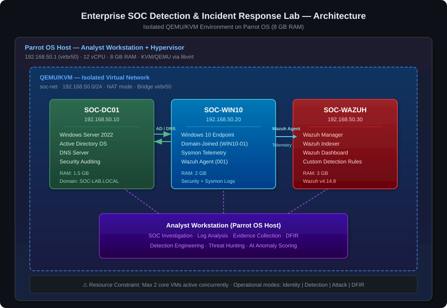
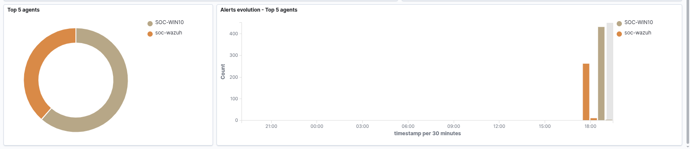
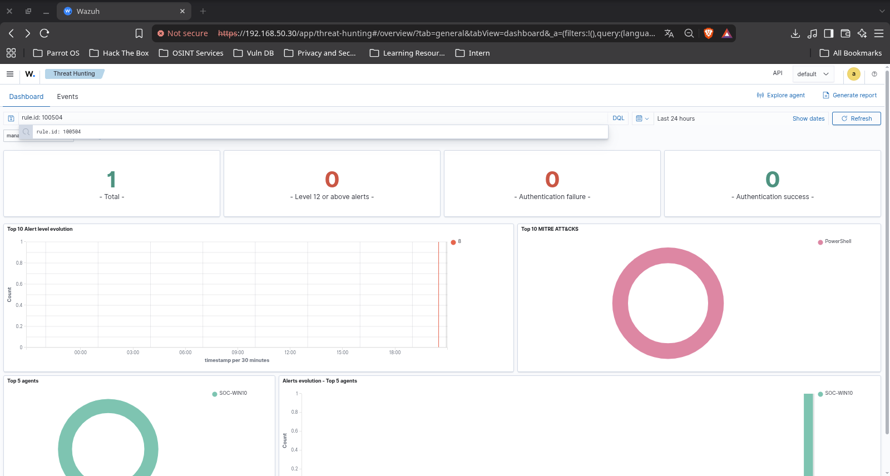
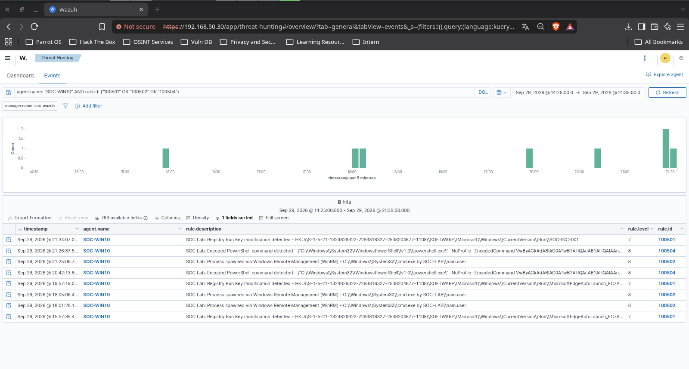
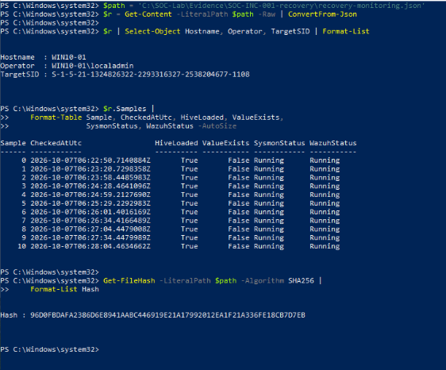

# Enterprise SOC Detection & Incident Response Lab

An evidence-driven Windows enterprise security operations lab demonstrating Active Directory endpoint telemetry, custom Wazuh SIEM detection engineering, alert triage, threat hunting, and digital forensics and incident response (DFIR). Designed and operated on an 8 GB RAM Linux workstation using QEMU/KVM with resource-aware virtual machine rotation (maximum two concurrent active VMs). All security simulations and response drills were conducted through authorized, controlled exercises to validate detection logic, test remediation procedures, and maintain SHA-256 evidence integrity verification.

---

## Featured Case Studies

The following case studies demonstrate detection, investigation, response, and evidence-based validation through independent, authorized lab exercises.

| Case Study | SOC Capabilities | Verified Outcome |
|---|---|---|
| **[INC-003 — Incident Response](incidents/INC-003/incident-report.md)** | Wazuh/Sysmon triage, targeted process containment, recovery verification, regression testing | Containment of simulated PID 4512; 3/3 scoped regression PASS; 7/7 SHA-256 checks PASS |
| **[Wazuh I/O Mitigation](docs/performance/wazuh-io-optimization-2026-10-14.md)** | Disk I/O profiling, feed-update troubleshooting, configuration backup and rollback planning | Guest I/O full PSI avg10: 60.13% to 0.00% in observed samples; Vulnerability Detection temporarily disabled |
| **[AD-002 — Authentication Detection](ad-labs/AD-002-authentication/README.md)** | Incorrect-password classification, same-account correlation, detection tuning | Rules 100507/100503; 3/3 synthetic regression PASS; live DC correlation verified |
| **[AD-003 — Authentication Investigation](incidents/AD-003/investigation-report.md)** | Windows authentication investigation, telemetry troubleshooting, live detection regression | Historical Agent-to-Manager connectivity failure investigated; ingestion recovery 3/3 PASS; scoped live detection regression 3/3 PASS |

**AD-003 evidence:** [Offline Validation](detections/ad-003/offline-validation-results.md) · [Live Regression Results](detections/ad-003/live-regression-results.md) · [Regression JSON Evidence](evidence/ad-003/AD003-R02-rule100503.json).

**Scope:** These are controlled lab simulations, not production incidents. Cross-account separation and 60-second timeframe-boundary tests remain outstanding for AD-003.

---

## Key Highlights

- **Active Directory & Endpoint Telemetry Baseline**
  Configured Windows Server 2022 (`SOC-DC01`) with Active Directory Domain Services and DNS (`SOC-LAB.LOCAL`) alongside a domain-joined Windows 10 endpoint (`SOC-WIN10`). Collected Windows Security EventChannels and Sysmon telemetry into Wazuh SIEM v4.14.8 over an isolated virtual network ([Architecture](architecture/topology.md) · [IP Plan](architecture/ip-plan.md)).

- **Custom Wazuh Detection Engineering & MITRE Mapping**
  Developed, tuned, and deployed 6+ custom Wazuh detection rules mapped to MITRE ATT&CK covering registry persistence, WinRM remote execution, encoded PowerShell, and logon anomalies, validated through automated test suites and live event validation ([Rules](configs/wazuh/rules/local_rules.xml) · [Test Suites](detections/wazuh/tests/encoded-powershell/README.md)).

- **Active Directory Detection Engineering (AD-001 & AD-002)**
  Implemented PowerShell Script Block detection for AD enumeration (`Rule 100506`, 2/2 live regression PASS) and an incorrect-password classifier (`Rule 100507`) with correlation tuning (`Rule 100503`, 3/3 synthetic regression PASS, live DC verification PASS, GitHub PR #2 merged) ([AD-001](ad-labs/AD-001-domain-enumeration/README.md) · [AD-002](ad-labs/AD-002-authentication/README.md)).

- **Structured Hypothesis-Driven Threat Hunting**
  Executed four structured hunts (HUNT-001 to HUNT-004) across encoded PowerShell, authentication anomalies, WinRM execution, and registry persistence. Identified rule blind spots (WinRM parent relationships) and demonstrated the principle that *Alert ≠ Incident* on shared benign autostart patterns ([Hunting Reports](hunting/README.md) · [MITRE Matrix](hunting/MITRE-COVERAGE.md)).

- **INC-003 — End-to-End Incident Response Capstone**
  Completed an authorized encoded PowerShell simulation using Sysmon and Wazuh: alert triage, targeted process containment, post-containment verification, 3/3 scoped regression tests, and 7/7 SHA-256 evidence checks ([Incident Report](incidents/INC-003/incident-report.md) · [Regression](detections/regression-tests/INC-003-regression.md)).

- **DFIR Acquisition & SHA-256 Evidence Integrity Verification**
  Reconstructed automated forensic event timelines with Python and JSON Schema (`DFIR-001`), acquired native Windows EVTX and Prefetch artifacts (`DFIR-002`, 261/261 SHA-256 verified), and corroborated historical hunting events against native Sysmon logs by ProcessGuid ([DFIR Cases](dfir/cases/)).

- **Lab Connectivity & Platform Validation (2026-10-26)**
  Booted all three VMs in rotation and verified `soc-net` reachability, AD DS/DNS/Kerberos/LDAP health, Wazuh dashboard/API availability, and live agent ingestion (42 alerts from `SOC-WIN10` within three minutes). Reusable check: [`automation/lab-connectivity-check.sh`](automation/lab-connectivity-check.sh) · [Evidence](evidence/lab-connectivity/lab-connectivity-20261026.md).

- **Network Security Mode Restored (2026-10-26)**
  Recreated the missing `Vung_LAN` / `Vung_WAN` libvirt networks, restored OPNsense 26.7 + Metasploitable 2, fixed the target address with a DHCP reservation (`10.0.0.5`), and verified FTP/SSH/HTTP plus firewall access. WAN-side recon from `192.168.50.10` is **filtered** while the same ports are **open** from the LAN, with PCAP evidence. Internal vsftpd 2.3.4 exploitation from the Parrot host yielded a root shell, an HTTP load test raised response time from 58 ms to 1,143 ms, Suricata 8.0.6 produced 10 IDS alerts for the WAN scan, and OPNsense syslog is forwarded to Wazuh through a host relay (rule `100011`). Check: [`automation/network-lab-check.sh`](automation/network-lab-check.sh) · [Mode](architecture/network-security-mode.md) · [Firewall Test](evidence/network-lab/firewall-test-20261026.md) · [Exploit](evidence/network-lab/exploit-vsftpd-20261026.md) · [DoS](evidence/network-lab/dos-http-20261026.md) · [IDS](evidence/network-lab/ids-suricata-20261026.md) · [Syslog](evidence/network-lab/syslog-integration-20261026.md).

---

## SOC Architecture

  

| Component | IP | Role |
|---|---|---|
| **SOC-DC01** | 192.168.50.10 | Windows Server 2022, Active Directory DS / DNS (2.0 GB RAM) |
| **SOC-WIN10** | 192.168.50.20 | Windows 10 Endpoint, Sysmon, Wazuh Agent (2.0 GB RAM) |
| **SOC-WAZUH** | 192.168.50.30 | Wazuh SIEM Manager, Indexer & Dashboard v4.14.8 (3.0 GB RAM) |
| **Parrot OS** | 192.168.50.1 | Hypervisor Host (QEMU/KVM), NAT Gateway, Analyst Workstation |

> **Naming:** the libvirt domain `SOC-DC01` runs the AD computer `DC01.soc-lab.local`; Wazuh agent IDs are `001` (`SOC-WIN10`) and `002` (`SOC-DC01`). See the [IP Plan](architecture/ip-plan.md) for verified service ports and DNS records.

**Cloud:** not deployed. The design and acceptance criteria for a future hybrid extension are in [Cloud Integration](architecture/cloud.md).

**Environment & Resource Operating Modes:**
- **Network**: Isolated libvirt NAT network `soc-net` (`192.168.50.0/24`) on bridge `virbr50`.
- **Domain**: `SOC-LAB.LOCAL` with active Kerberos authentication and centralized DNS.
- **Hardware Constraints**: The lab operates on a physical 8 GB RAM host. VMs rotate across four operational profiles to enforce a strict limit of two concurrent running VMs ([Resource Operating Modes](architecture/resource-modes.md)):
  - *Identity Mode* (`SOC-DC01` + `SOC-WIN10`): Domain management, joining endpoints, Kerberos ticket logging.
  - *Detection Mode* (`SOC-WIN10` + `SOC-WAZUH`): Sysmon and EventChannel telemetry ingestion, alert testing.
  - *Attack Mode* (`SOC-WIN10` + `SOC-WAZUH` / `SOC-DC01`): Controlled adversary technique simulations.
  - *DFIR Mode* (Target Windows VM + Parrot OS): Forensic artifact acquisition and timeline verification.
  - *Network Security Mode* (`OPNsense-Lab6` + `Metasploitable2`): Firewall, DMZ, reconnaissance, scanning and IDS exercises ([details](architecture/network-security-mode.md)). Runs separately from the SOC rotation.

---

## SOC Workflow

*This workflow represents the lab’s demonstrated SOC capabilities, illustrating telemetry ingestion, detection logic development, hypothesis-driven hunting, forensic timeline construction, containment verification, and detection tuning. Individual exercises and response drills were conducted and documented in distinct, controlled modules rather than as a single continuous incident.*

---

## Detection Engineering

### Verified Custom Detection Rules

Core detection rules are maintained in [`configs/wazuh/rules/local_rules.xml`](configs/wazuh/rules/local_rules.xml) with modular definitions in [`detections/wazuh/rules/`](detections/wazuh/rules/).

| Rule ID | Detection | Telemetry | MITRE ATT&CK | Evidence |
|---|---|---|---|---|
| [**100501**](configs/wazuh/rules/local_rules.xml) | Registry Run Key modification | Sysmon EID 13 | [T1112](https://attack.mitre.org/techniques/T1112/) / [T1547.001](https://attack.mitre.org/techniques/T1547/001/) | [HUNT-004](hunting/HUNT-004-persistence.md) · [SOC-INC-001 Timeline](incidents/SOC-INC-001/timeline.md) |
| [**100502**](configs/wazuh/rules/local_rules.xml) | WinRM process execution | Sysmon EID 1 | [T1021.006](https://attack.mitre.org/techniques/T1021/006/) | [HUNT-003](hunting/HUNT-003-winrm.md) · [SOC-INC-001 Timeline](incidents/SOC-INC-001/timeline.md) |
| [**100503**](configs/wazuh/rules/local_rules.xml) | Tuned incorrect-password correlation | Windows EID 4625 | [T1110](https://attack.mitre.org/techniques/T1110/) | [AD-002 Regression](ad-labs/AD-002-authentication/regression-results.md) · [Live Correlation](evidence/ad-002/AD002-live-correlation-100503-20261009.json) · [AD-003 Live Regression](detections/ad-003/live-regression-results.md) |
| [**100504**](configs/wazuh/rules/local_rules.xml) | Encoded PowerShell command | Sysmon EID 1 | [T1059.001](https://attack.mitre.org/techniques/T1059/001/) | [HUNT-001](hunting/HUNT-001-powershell.md) · [Live Tests](detections/wazuh/tests/encoded-powershell/README.md) |
| [**100506**](detections/wazuh/rules/100506-ad-enumeration.xml) | Active Directory enumeration | PowerShell EID 4104 | [T1087.002](https://attack.mitre.org/techniques/T1087/002/) | [AD-001 Lab](ad-labs/AD-001-domain-enumeration/README.md) · [Live Regression](evidence/ad-001/AD001-regression-20261009.json) |
| [**100507**](detections/wazuh/rules/100507-incorrect-password.xml) | Incorrect-password classifier | Windows EID 4625 | [T1110](https://attack.mitre.org/techniques/T1110/) | [AD-002 Lab](ad-labs/AD-002-authentication/README.md) · [Live Detection](evidence/ad-002/AD002-live-detection-100507-20261009.json) · [AD-003 Live Regression](detections/ad-003/live-regression-results.md) |

### Active Directory Detection Engineering Case Studies

#### AD-001: Active Directory Enumeration Detection
- **Telemetry Source**: Windows PowerShell Script Block Logging (Event ID 4104) on `SOC-DC01` forwarded via Wazuh Agent 002.
- **Custom Rule**: [`Rule 100506`](detections/wazuh/rules/100506-ad-enumeration.xml) (Level 3), mapped to MITRE ATT&CK [T1087.002](https://attack.mitre.org/techniques/T1087/002/) (Domain Account Discovery).
- **Detection Gap & Tuning**: Investigated a rule-matching gap where raw events appeared in Wazuh archives but did not alert; resolved by inheriting from built-in PowerShell Rule 91802.
- **Regression Verification**: Controlled live regression achieved **2/2 PASS**:
  - *Positive control*: `Get-ADUser` execution triggered Alert 100506 (Event Record 832).
  - *Negative control*: Benign `Get-Date` execution produced no alert (Event Record 837).
- **Reports & Artifacts**: [AD-001 Case Study](ad-labs/AD-001-domain-enumeration/README.md) · [Live Regression Evidence](evidence/ad-001/AD001-regression-20261009.json)

#### AD-002: Authentication Classifier & Correlation Tuning
- **Telemetry Source**: Windows Security Audit Event ID 4625 (Logon Failure) on `SOC-DC01` (Active Directory Domain Controller).
- **Classifier Rule**: Developed [`Rule 100507`](detections/wazuh/rules/100507-incorrect-password.xml) (Level 3) matching Event 4625 with SubStatus `0xc000006a` to specifically isolate incorrect-password attempts from other logon failures.
- **Correlation Tuning**: Tuned [`Rule 100503`](configs/wazuh/rules/local_rules.xml) (Level 10, MITRE ATT&CK [T1110](https://attack.mitre.org/techniques/T1110/)) to correlate 5 matching incorrect-password events within 60 seconds against the same target account. *Note: this detects repeated failed attempts for a specific account, not multi-account password spraying.*
- **Synthetic Regression**: Replayed archived Windows authentication telemetry through `wazuh-logtest` across 3 test cases (8 incorrect passwords, 8 logon-rights failures, and 4+4 mixed events) achieving **3/3 PASS**.
- **Live DC Verification**: Generated 5 controlled invalid-password attempts against test account `soc.ad002.test`; confirmed 4 classifier alerts (Rule 100507) and 1 correlation alert (Rule 100503 on Event Record 23033) (**PASS**).
- **Deployment & PR**: Configuration validated with `wazuh-analysisd -t`, deployed via controlled service restart, and merged in [GitHub PR #2](https://github.com/nnam099/enterprise-soc-detection-ir-lab/pull/2).
- **Reports & Artifacts**: [AD-002 Case Study](ad-labs/AD-002-authentication/README.md) · [Regression Results](ad-labs/AD-002-authentication/regression-results.md) · [Live Correlation Evidence](evidence/ad-002/AD002-live-correlation-100503-20261009.json)

---

## Investigation, Incident Response & DFIR

| Case Study | Focus & Scope | Verified Technical Outcome | Documentation & Evidence |
|---|---|---|---|
| **INC-003** | Controlled PowerShell IR | Rule 92057 detection, PID 4512 containment, post-containment checks, 3/3 scoped regression PASS, 7/7 evidence hashes verified. Authorized benign simulation. | [Incident Report](incidents/INC-003/incident-report.md) · [Timeline](incidents/INC-003/timeline.md) · [Evidence](incidents/INC-003/evidence-manifest.md) |
| **HUNT-001–004** | Threat Hunting | Investigated encoded PowerShell, logon bursts, WinRM executions, and Run keys. Identified WinRM parent-process blind spots and demonstrated that benign Edge autostart shares Run key alert signatures with persistence (**Alert ≠ Incident**). | [Threat Hunting Reports](hunting/README.md) · [MITRE Matrix](hunting/MITRE-COVERAGE.md) |
| **SOC-INC-001** | Incident Investigation & Response | Correlated a controlled 3-stage simulation (`wsmprovhost.exe` → encoded PowerShell → Run key) over a 9-minute window. Separately verified containment and recovery: process termination (`Stop-Process`), AD account disable/restore (`4725`/`4722`), and Run key absence across 11 monitoring samples. | [Capstone Report](incidents/SOC-INC-001/capstone-report.md) · [Timeline](incidents/SOC-INC-001/timeline.md) · [Analysis](incidents/SOC-INC-001/analysis.md) |
| **INC-002** | Detection Tuning | Investigated a high-severity (level 15) alert triggered by Edge WebView2 Speech DLL unpacking in user Temp, assessed as likely benign. Narrowed Rule 100001 predicate to match the specific executable path and temp unpacker pattern, verified via adapted historical replay. | [Triage Report](incidents/INC-002-wazuh-fp-tuning/triage-report.md) |
| **DFIR-001** | Timeline Reconstruction | Automated event timeline compilation from threat hunt exports using a Python pipeline (`build_timeline.py`). Output JSONL, CSV, and Markdown timelines validated against JSON Schema and verified against SHA-256 manifests. | [Investigation Report](dfir/cases/DFIR-001/investigation-report.md) · [Evidence Manifest](dfir/cases/DFIR-001/evidence-manifest.md) |
| **DFIR-002** | Endpoint Artifact Acquisition | Acquired 3 native EVTX channels (54.7 MB) and 255 Prefetch files from `SOC-WIN10` with 261/261 SHA-256 checks passing. Corroborated SIEM hunting records for HUNT-003 and HUNT-004 against native Sysmon events by Record ID and ProcessGuid. | [DFIR-002 Overview](dfir/cases/DFIR-002/README.md) · [Acquisition Report](dfir/cases/DFIR-002/acquisition-report.md) · [Correlation Report](dfir/cases/DFIR-002/correlation-report.md) |

*Simulations, threat hunts, and response exercises were conducted and documented independently with discrete timestamps and evidence artifacts rather than as a single continuous incident lifecycle.*

---

## Evidence Gallery

<table>
<tr>
<td width="50%">

**Wazuh Endpoint Telemetry Ingestion**
Windows Security and Sysmon telemetry ingested into Wazuh SIEM from domain endpoint `SOC-WIN10`.

</td>
<td width="50%">

**Custom Detection Alert (Rule 100504)**
Alert firing on obfuscated PowerShell execution with `-EncodedCommand` (mapped to MITRE ATT&CK T1059.001).

</td>
</tr>
<tr>
<td width="50%">

**Incident Investigation Timeline**
Multi-alert correlation view for SOC-INC-001: WinRM execution, encoded PowerShell, and Registry Run key persistence.

</td>
<td width="50%">

**Remediation & Monitoring Verification**
Sampled post-containment verification confirming Run Key value absence during sampled monitoring and operational health of endpoint agents.

</td>
</tr>
</table>

---

## Repository Navigation

| Directory | Description |
|---|---|
| [`architecture/`](architecture/) | Network topology, IP addressing plan, 8 GB resource modes, network security mode, cloud integration plan, and architectural diagram |
| [`configs/`](configs/) | Deployed Wazuh custom rules (`local_rules.xml`) and SIEM configuration files |
| [`automation/`](automation/) | Reusable read-only checks, including [`lab-connectivity-check.sh`](automation/lab-connectivity-check.sh) and [`network-lab-check.sh`](automation/network-lab-check.sh) |
| [`attacks/`](attacks/) | Authorized, non-destructive lab simulations (WAN recon with PCAP) |
| [`detections/`](detections/) | Custom Wazuh XML rules, test cases, and regression test suites |
| [`ad-labs/`](ad-labs/) | Active Directory detection engineering case studies (AD-001 enumeration, AD-002 authentication) |
| [`hunting/`](hunting/) | Hypothesis-driven threat hunting reports (HUNT-001–004) and MITRE ATT&CK coverage matrix |
| [`incidents/`](incidents/) | Controlled incident investigations (SOC-INC-001, INC-003) and detection tuning case studies (INC-002) |
| [`dfir/`](dfir/) | Digital forensics case studies (DFIR-001, DFIR-002), timeline pipelines, and checksum manifests |
| [`evidence/`](evidence/) | Host baselines, live regression outputs, and cryptographic hash verification logs |
| [`screenshots/`](screenshots/) | Visual evidence of lab infrastructure, telemetry, alerts, investigation, and recovery |
| [`ai/`](ai/) | Auxiliary Isolation Forest machine learning anomaly scoring experiments |

---

## Technical Summary

Practical SOC operations require moving beyond passive alert monitoring to understand the full telemetry lifecycle: raw event generation, detection engineering, behavioral triage, forensic artifact corroboration, and disciplined documentation. Operating within an 8 GB constraint reinforced resource prioritization, precise hypothesis formulation, and SHA-256 evidence integrity verification across Git-managed workflows.

*All security simulations, authentication tests, and administrative actions were authorized, non-destructive, and executed strictly within an isolated virtual lab environment.*

---

  <i>Built and maintained by <a href="https://github.com/nnam099">nnam099</a> — SOC Analyst Portfolio</i>

