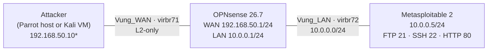

# Network Security Mode

**Status:** Operational (restored 2026-10-26)

This mode reuses the course lab components (`OPNsense-Lab6`, `Metasploitable2`) to cover the network-attack and firewall portions of the Network Security syllabus. It is separate from the SOC detection mode and must not run at the same time as the SOC VMs on the 8 GB host.

---

## Topology



\* The attacker IP is reserved for a future Kali VM. On this host the Parrot machine is attached to `virbr72` as `10.0.0.254` for validation only.

---

## Virtual Networks

| Network | Bridge | Subnet | Host IP | Notes |
|---|---|---|---|---|
| `Vung_WAN` | `virbr71` | 192.168.50.0/24 | **none** (L2-only) | OPNsense WAN `.1`; isolated, no NAT/forward |
| `Vung_LAN` | `virbr72` | 10.0.0.0/24 | 10.0.0.254 | OPNsense LAN `.1`; DHCP `.100–.200`; reservation `.5` |

### Why `Vung_WAN` is L2-only

The original Lab 6 setup gave the libvirt bridge the same `.1` address as the OPNsense WAN interface, causing duplicate-IP/ARP problems. The fix is a bridge without an IP; OPNsense owns `192.168.50.1` exclusively.

### IP overlap warning

`Vung_WAN` uses `192.168.50.0/24`, the same subnet as `soc-net`. This is safe only because:

- `Vung_WAN` has **no host IP** and is isolated (no forward).
- SOC VMs are shut down while Network Security Mode runs.

When OPNsense is next reconfigured, renumber its WAN to `192.168.70.0/24` to remove the overlap permanently. Until then, **never run SOC VMs and this mode together**.

---

## DHCP Reservation

`Metasploitable2` has no static IPv4 configured in the guest. `Vung_LAN` provides a fixed lease:

```xml
<dhcp>
  <range start='10.0.0.100' end='10.0.0.200'/>
  <host mac='52:54:00:86:b8:60' name='metasploitable' ip='10.0.0.5'/>
</dhcp>
```

This keeps the address stable across reboots without editing the guest.

---

## Start / Stop

```bash
# start
virsh -c qemu:///system start OPNsense-Lab6
virsh -c qemu:///system start Metasploitable2

# verify
./automation/network-lab-check.sh

# stop (OPNsense handles ACPI; Metasploitable does not — use console `sudo poweroff`)
virsh -c qemu:///system shutdown OPNsense-Lab6
virsh -c qemu:///system shutdown Metasploitable2
```

Resource use: OPNsense 1.5 GiB + Metasploitable 0.5 GiB ≈ **2 GiB**, which fits the 8 GB host.

---

## Verified Services (2026-10-26)

| Target | Check | Result |
|---|---|---|
| 10.0.0.1 | ICMP + HTTPS | 0% loss, HTTP `200` |
| 10.0.0.5 | DHCP lease | `10.0.0.5/24`, MAC `52:54:00:86:b8:60` |
| 10.0.0.5 | TCP 21/22/80 from LAN | open (vsftpd 2.3.4, OpenSSH 4.7p1, Apache 2.2.8) |
| 10.0.0.5 | TCP 21/22/80 from WAN | **filtered** by OPNsense |
| 192.168.50.1 | TCP 443 from WAN | **filtered** |

### WAN-Side Attacker (Temporary)

`Attacker-MSF` is a disposable Metasploitable-derived clone used to validate the WAN path:

| Setting | Value |
|---|---|
| WAN NIC | `Vung_WAN`, 192.168.50.10/24 |
| Management NIC | `default` (libvirt DHCP) |
| Disk | standalone copy `/home/nnam09/VM/lab/Attacker-MSF-standalone.qcow2` |
| RAM / vCPU | 512 MiB / 1 |

The attacker resolves OPNsense's WAN MAC but every scanned port is filtered, confirming firewall policy rather than a routing failure. See [firewall test evidence](../evidence/network-lab/firewall-test-20261026.md) and [PCAP](../evidence/network-lab/pcap/wan-scan-20261026.pcap).

> This clone is a validation aid, not the final course attacker. Replace it with Kali when available.


---

## Course Mapping

| Syllabus topic | Use in this mode |
|---|---|
| Ch2 — protocol/device vulnerabilities | Metasploitable 2 exposed services (vsftpd 2.3.4, Apache 2.2.8, OpenSSH 4.7p1) |
| Ch3.1 — reconnaissance | Host discovery and service enumeration against 10.0.0.5 |
| Ch3.2 — scanning | Nmap connect/version scan, with and without the firewall |
| Ch3.3 — intrusion | Controlled exploit of a lab-only service (e.g. vsftpd 2.3.4) |
| Ch3.4 — DoS | Rate/connection exhaustion against the lab target, detected at OPNsense |
| Ch4 — prevention/response | OPNsense rules, IDS alerts, containment and evidence capture |
| Lab 5 | Firewall topology / DMZ concepts |
| Lab 6 | Recon with and without a firewall |

---

## Next Steps (Course Completion)

1. **Suricata IDS** runs as the OPNsense IDS service (PID 53430) with custom lab rules; `eve.json` is forwarded to Wazuh (rule `86601`). Remaining: IPS mode and ET rulesets.
2. `Attacker-MSF` already covers the WAN side; a Kali VM is optional for a course-style demo.
3. The LAN exploit chain (vsftpd → root shell) is complete. A WAN-side exploit is optional.
4. Recon PCAP is captured; an exploit-stage PCAP remains optional.
5. Add Wazuh rules for port scan, FTP exploit, and SSH brute force.
6. Write the Vietnamese report and map each section to Ch1–Ch4.

## Safety

- `Vung_WAN` has no forward/NAT; the lab cannot reach the internet through it.
- Never expose Metasploitable 2 to a physical or untrusted network.
- Do not run this mode together with `SOC-DC01`, `SOC-WIN10`, or `SOC-WAZUH` on the 8 GB host.
