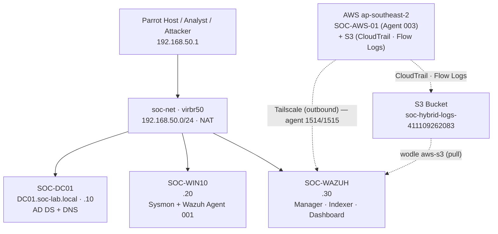

# SOC Lab Topology

## Data Flow

| Source | Destination | Port | Purpose |
|---|---|---|---|
| SOC-WIN10 (agent 001) | SOC-WAZUH | 1514/tcp | Event ingest |
| SOC-WIN10 (agent 001) | SOC-WAZUH | 1515/tcp | Agent enrollment |
| Analyst (Parrot host) | SOC-WAZUH | 443/tcp | Dashboard |
| Analyst (Parrot host) | SOC-WAZUH | 55000/tcp | Wazuh API |
| SOC-WIN10 | SOC-DC01 | 53, 88, 389, 445 | DNS, Kerberos, LDAP, SMB |
| Analyst (Parrot host) | SOC-WIN10 | 5985/tcp | WinRM (service dependent) |
| EC2 `SOC-AWS-01` (003) | SOC-WAZUH | 1514/1515/tcp | Agent ingest + enrollment over Tailscale |
| SOC-WAZUH (wodle aws-s3) | S3 bucket | 443/tcp (HTTPS) | Pull CloudTrail / Flow Logs |

The lab uses a dedicated libvirt NAT network named `soc-net` on bridge `virbr50`.

- `soc-net` is persistent, active and set to autostart.
- VMs are **not** set to autostart; they are started in rotation according to [`resource-modes.md`](resource-modes.md).
- Internet egress is available through the host NAT, but no lab VM is intentionally exposed to the internet.
- Cloud integration is **deployed** (Recommendation #1, hybrid); see [`cloud.md`](cloud.md) and [`../cloud/`](../cloud/).

## Network Security Mode

A separate, isolated mode reuses OPNsense and Metasploitable 2 for the Network Security course:

- `Vung_WAN` (`virbr71`, L2-only) — OPNsense WAN `192.168.50.1/24`
- `Vung_LAN` (`virbr72`, `10.0.0.0/24`) — OPNsense LAN `10.0.0.1`, Metasploitable `10.0.0.5`
- No forwarding/NAT; do not run it together with the SOC VMs.

See [`network-security-mode.md`](network-security-mode.md) for topology, validation and course mapping.
