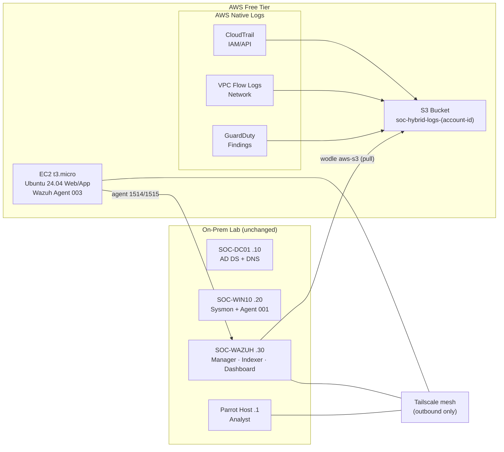

# SOC Hybrid Cloud — Recommendation #1 (On-Prem Wazuh + AWS Free Tier)

> **Status (2026-10-27): DEPLOYED** — provisioned manually (AWS Management Console + CLI),
> not via this Terraform package. This directory is the design reference and reusable
> automation for the same topology; its values are aligned with the live environment
> (`ap-southeast-2`, VPC `10.20.0.0/16`, instance `SOC-AWS-01`). See
> [`architecture/cloud.md`](../architecture/cloud.md) and
> [`evidence/cloud/cloud-deployment-20261027.md`](../evidence/cloud/cloud-deployment-20261027.md).

---

## Overview

Keep the existing on-prem cluster untouched — `SOC-DC01` (.10), `SOC-WIN10`
(.20), `SOC-WAZUH` (.30) — and add an AWS branch that feeds three new telemetry
sources back into the same on-prem Wazuh SIEM:



**Why this over a cloud Wazuh manager:** the SIEM stays on-prem (no 4–8 GB EC2
for Indexer/Manager, no public dashboard), while still demonstrating a genuine
hybrid detection posture across three planes:

| Plane | Source | Telemetry |
|---|---|---|
| Endpoint / identity (on-prem) | `SOC-WIN10`, `SOC-DC01` | Sysmon, Security, PowerShell |
| Linux workload (cloud) | `SOC-AWS-01` | auditd, syslog, nginx |
| AWS control plane (cloud) | CloudTrail / Flow Logs / GuardDuty | IAM/API, network, findings |

---

## Repository Layout

| Path | Purpose |
|---|---|
| [`cloud/terraform/`](terraform/) | Terraform IaC (EC2, S3, CloudTrail, Flow Logs, GuardDuty, IAM) |
| [`cloud/wazuh/wodle-aws-s3.conf`](wazuh/wodle-aws-s3.conf) | Wazuh manager `aws-s3` wodle fragment |
| [`cloud/wazuh/aws-credentials.example`](wazuh/aws-credentials.example) | AWS shared credentials template for SOC-WAZUH |
| [`cloud/iam/wazuh-s3-reader-policy.json`](iam/wazuh-s3-reader-policy.json) | Reference least-privilege S3 reader policy |
| [`automation/cloud-check.sh`](../automation/cloud-check.sh) | Read-only AWS-side health check |
| [`acceptance.md`](acceptance.md) | Acceptance criteria + evidence checklist |

---

## Prerequisites

- AWS account in Free Tier (12 months), region `ap-southeast-2` (or adjust).
- `terraform` (>= 1.3) and `aws` CLI installed on the analyst (Parrot) host.
- A Tailscale account (Personal plan: 3 users / 100 devices, free).
- SOC-WAZUH (Wazuh v4.14.8) reachable over Tailscale at a stable `100.x.y.z` IP.

---

## Phase 0 — Accounts & credentials

1. Create the Tailscale tailnet; generate an **auth key** (Settings → Keys →
   Generate auth key) for unattended `tailscale up` on EC2.
2. Install Tailscale on the Parrot host and on SOC-WAZUH:
   ```bash
   curl -fsSL https://tailscale.com/install.sh | sh
   sudo tailscale up
   ```
   Note the SOC-WAZUH Tailscale IP (`tailscale ip -4`) — it becomes
   `wazuh_manager_ip` in Terraform.
3. Configure AWS CLI on the Parrot host with a role that can run `terraform
   apply` (admin for this lab) and, separately, read-only creds for
   `automation/cloud-check.sh`.

---

## Phase 1 — Deploy AWS (Terraform)

```bash
cd cloud/terraform
cat > terraform.tfvars <<'EOF'
region                      = "ap-southeast-2"
wazuh_manager_ip            = "100.x.y.z"          # SOC-WAZUH Tailscale IP
wazuh_agent_name            = "SOC-AWS-01"
wazuh_registration_password = "<authd password>"
tailscale_authkey           = "tskey-auth-..."
EOF
terraform init
terraform plan
terraform apply
```

Capture for later:

```bash
terraform output log_bucket
terraform output wazuh_reader_access_key_id
terraform output wazuh_reader_secret_access_key
```

> `wazuh_agent_name` = `SOC-AWS-01` registers as agent **003** (after 001
> SOC-WIN10, 002 SOC-DC01), keeping the naming scheme consistent.

---

## Phase 2 — Verify the EC2 workload

The `user_data` bootstrap installs Tailscale + nginx + auditd + the Wazuh agent.

1. Connect via SSM (no SSH exposed):
   ```bash
   aws ssm start-session --target $(terraform -chdir=cloud/terraform output -raw ec2_instance_id)
   ```
2. Confirm bootstrap:
   ```bash
   tailscale status          # expect soc-aws-01
   systemctl status wazuh-agent nginx
   sudo cat /var/log/soc-hybrid-bootstrap.log
   ```
3. From SOC-WAZUH, confirm the new agent enrolled and is **Active**:
   ```bash
   /var/ossec/bin/agent_control -l        # expect SOC-AWS-01 (003) Active
   ```

---

## Phase 3 — Configure the Wazuh `aws-s3` wodle (SOC-WAZUH)

1. Store the reader credentials (mode 0600, root-owned):
   ```bash
   sudo mkdir -p /var/ossec/.aws
   sudo tee /var/ossec/.aws/credentials >/dev/null <<'EOF'
   [wazuh-aws]
   aws_access_key_id = <access key id>
   aws_secret_access_key = <secret access key>
   region = ap-southeast-2
   EOF
   sudo chmod 600 /var/ossec/.aws/credentials
   ```
2. Merge [`cloud/wazuh/wodle-aws-s3.conf`](wazuh/wodle-aws-s3.conf) into
   `/var/ossec/etc/ossec.conf` (inside `<ossec_config>`), replacing
   `SOC-HYBRID-LOGS-BUCKET` with the real bucket name.
3. Validate and restart:
   ```bash
   sudo /var/ossec/bin/wazuh-analysisd -t   # config test (analysisd)
   sudo systemctl restart wazuh-manager
   ```
   The `aws-s3` module is driven by `wazuh-modulesd`; verify it starts without
   credential errors in `/var/ossec/logs/ossec.log`.

---

## Phase 4 — Generate telemetry & confirm detection

| Source | Trigger | Wazuh evidence |
|---|---|---|
| CloudTrail | `aws sts get-caller-identity` / console login, or create an S3 object | alert on API events (built-in rule 802xx) |
| VPC Flow Logs | `curl` from EC2 to any internet host over Tailscale/IGW | network flow records |
| GuardDuty | SSH brute-force or port scan toward EC2 public IP (or generate a finding) | GuardDuty finding → S3 → Wazuh |

Then confirm ingestion on SOC-WAZUH:

```bash
# New documents in the alerts index with location s3/aws
sudo grep -i "aws-s3\|wodle" /var/ossec/logs/ossec.log | tail -20
# Or via the dashboard: filter location ~ "s3" / rule group "amazon,"
```

Run the AWS-side read-only check from the analyst host:

```bash
SOC_CLOUD_BUCKET=$(terraform -chdir=cloud/terraform output -raw log_bucket) \
  ./automation/cloud-check.sh
```

---

## Cost Estimate

| Line item | Est. monthly cost |
|---|---|
| EC2 `t3.micro` (750 h/mo Free Tier) | $0 |
| S3 storage (under Free Tier 5 GB) | $0 |
| CloudTrail (first copy) | $0 |
| VPC Flow Logs | $0 |
| GuardDuty (30-day trial, then low-volume) | ~$0–2 |
| KMS key (GuardDuty findings encryption) | **~$1** |
| **Total** | **~$1–3 / month** |

Set a **budget alarm** and a stop schedule if you keep the instance running
beyond testing.

---

## Security & Constraints

- **No inbound security-group rules** — the EC2 instance exposes no ports to the
  internet; management is SSM Session Manager + Tailscale (both outbound).
- **No public 22/9200/55000** — SSH is not open; the Wazuh dashboard and API
  remain on-prem behind the isolated `soc-net`.
- **Least-privilege IAM** — the on-prem Wazuh reader has `s3:ListBucket` +
  `s3:GetObject` on the log bucket only, plus `kms:Decrypt` on the GuardDuty key.
- **Do not commit** `terraform.tfvars`, `.tfstate`, access keys, or the Wazuh
  enrollment password. See [`cloud/terraform/.gitignore`](terraform/.gitignore).

---

## Teardown

```bash
aws s3 rm s3://$(terraform -chdir=cloud/terraform output -raw log_bucket) --recursive
terraform -chdir=cloud/terraform destroy
```

Remove the EC2 agent from SOC-WAZUH with `agent_control -r 003` if desired.

---

See [`acceptance.md`](acceptance.md) for the completion criteria that gate
promoting this from **PACKAGE READY** to **DEPLOYED**.
