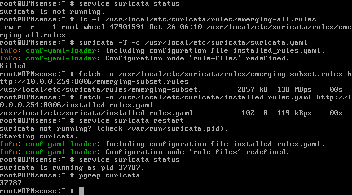

# ET Open Rules in OPNsense IDS (2026-10-26)

**Objective:** Add Emerging Threats Open rules to the OPNsense IDS service and, if possible, switch to IPS mode.

**Result:** **PARTIAL** — ET Open **subset** (3,469 rules) loads successfully in IDS mode. **IPS mode could not be enabled** on this OPNsense 26.7 + virtio build; the full ET Open set (52,752 rules) is OOM-killed on the 1.5 GB VM.

---

## ET Open Load

Downloaded `suricata-8.0/emerging.rules.tar.gz` (5.4 MB, 54 files) and built a subset:

```sh
cat emerging-scan.rules emerging-dos.rules emerging-attack_response.rules \
    emerging-exploit.rules emerging-web_server.rules > emerging-subset.rules
```

- Subset size: **2.8 MB**
- Rules: **3,469**
- Full set: 52,752 rules / 46 MB → `suricata -T` was **Killed** (OOM on 1.5 GB)

OPNsense:

```text
/usr/local/etc/suricata/rules/emerging-subset.rules   2857 KB
/usr/local/etc/suricata/installed_rules.yaml:
  rule-files:
    - /root/lab.rules
    - /usr/local/etc/suricata/rules/emerging-subset.rules

service suricata status
  suricata is running as pid 37787.
```



---

## IPS Attempt

| Check | Result |
|---|---|
| `kldload netmap` | "module already loaded or in kernel" → netmap available |
| IDS model set to `netmap` | Config confirmed `MODEL=[netmap] IFACE=[wan]` |
| Generated `suricata.yaml` | Still `netmap: - interface: default`; no `vtnet1` entry |
| `divert` mode | No `divert:` section generated |
| Service in IPS mode | Not achieved on virtio |

The OPNsense 26.7 template does not render the inline interface for this VM/NIC combination. Enabling IPS would require fixing the template/interface mapping, a netmap-compatible NIC, or more RAM and a manual inline configuration.

**Current state:** IDS (pcap on `vtnet1`) is running; IPS is documented as not available.

---

## Evidence

- Screenshot: [`screenshots/phase7-network/opnsense-et-subset-20261026.png`](../../screenshots/phase7-network/opnsense-et-subset-20261026.png)
- Screenshot (config test): [`screenshots/phase7-network/opnsense-et-config-test-20261026.png`](../../screenshots/phase7-network/opnsense-et-config-test-20261026.png)
- Fetch/build script: [`automation/fetch-et-open.sh`](../../automation/fetch-et-open.sh)

ET rules are third-party content and are **not committed** to this repository.

---

## Limitations

| Item | Status |
|---|---|
| Rule coverage | Subset only (scan/DoS/attack-response/exploit/web-server) |
| Full ET Open | OOM on 1.5 GB OPNsense VM |
| IPS | Not functional; netmap inline template issue |
| Rulesets | No OPNsense-managed ET ruleset/update mechanism; manual file |
| Updates | Manual re-download; no scheduled update |
| Wazuh | Existing `eve.json` → Wazuh pipeline applies to any ET alerts |
| License | ET Open terms apply; do not commit the rule files |

## Recommended Next Steps

1. Increase OPNsense RAM (2.5–3 GB) before loading more rules.
2. Fix the OPNsense netmap template/interface mapping or use a netmap-supported NIC for IPS.
3. Add a scheduled ET Open update (manual script or OPNsense ruleset package if internet is provided).
4. Test ET alerts with a broader scan and confirm they reach Wazuh via rule `86601`.
