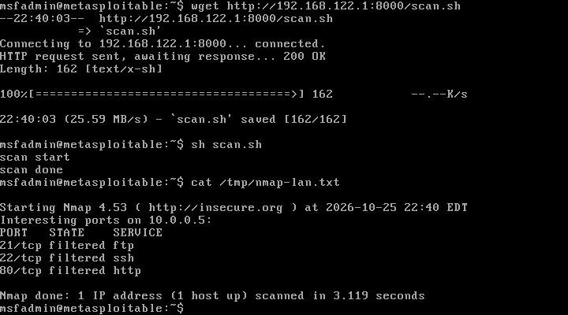
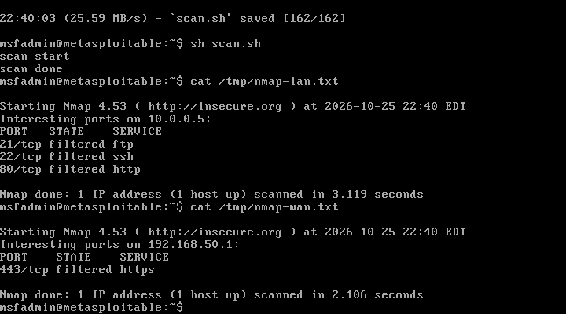
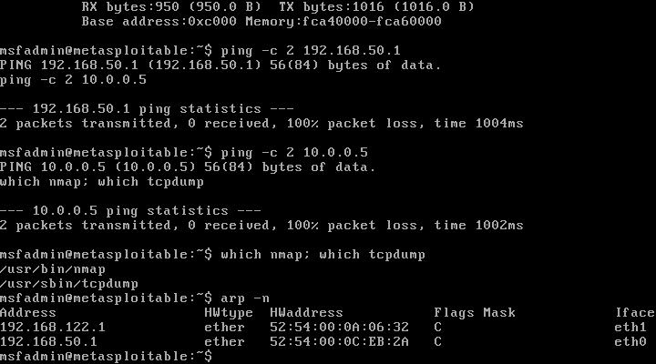
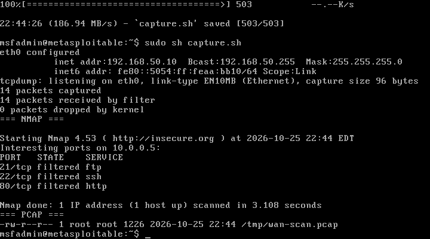

# WAN-Side Recon Through OPNsense — Validation (2026-10-26)

**Objective:** Prove the firewall behavior for the Network Security course: the same target is reachable from the LAN side but filtered from the WAN side, with packet capture evidence.

**Result:** **PASS** — from `192.168.50.10` (WAN), TCP 21/22/80 toward `10.0.0.5` are **filtered**; from the LAN validation host, they are **open**.

---

## Setup

| Role | Address | Notes |
|---|---|---|
| Attacker | 192.168.50.10/24 on `Vung_WAN` | `Attacker-MSF` (temporary Metasploitable-derived clone), management NIC on `default` |
| Firewall | WAN 192.168.50.1/24 · LAN 10.0.0.1/24 | OPNsense 26.7 |
| Target | 10.0.0.5/24 on `Vung_LAN` | Metasploitable 2, DHCP reservation |

The attacker was placed on `Vung_WAN` so traffic must traverse OPNsense. The host-side `10.0.0.254` on `Vung_LAN` was used for the "inside / no firewall" comparison.

> The attacker is a temporary clone, not the final Kali VM. It is sufficient to validate the network path and firewall behavior; replace it with Kali for the course demo if required.

---

## Results

### From the LAN side (no firewall traversal)

```text
21/tcp open  ftp     vsftpd 2.3.4
22/tcp open  ssh     OpenSSH 4.7p1
80/tcp open  http    Apache 2.2.8
```

### From the WAN side (through OPNsense)

```text
Nmap 4.53 at 2026-10-25 22:44 EDT
Interesting ports on 10.0.0.5:
PORT   STATE    SERVICE
21/tcp filtered ftp
22/tcp filtered ssh
80/tcp filtered http
```

```text
Interesting ports on 192.168.50.1:
PORT    STATE    SERVICE
443/tcp filtered https
```





### ARP resolution confirms the path

```text
Address          HWtype  HWaddress           Flags Mask  Iface
192.168.50.1     ether   52:54:00:0C:EB:2A   C           eth0
```

The attacker resolves OPNsense's WAN MAC, so the filtering is a firewall policy decision — not a routing/L2 failure.



---

## Packet Capture

`evidence/network-lab/pcap/wan-scan-20261026.pcap` — 14 packets, 1.2 KB, 5.38 s.

```text
ARP, Request who-has 192.168.50.1 tell 192.168.50.10
ARP, Reply 192.168.50.1 is-at 52:54:00:0c:eb:2a
IP 192.168.50.10.52803 > 10.0.0.5.21: Flags [S]
IP 192.168.50.10.53070 > 10.0.0.5.22: Flags [S]
IP 192.168.50.10.57568 > 10.0.0.5.80: Flags [S]
IP 192.168.50.10.52808 > 10.0.0.5.21: Flags [S]   (retransmission)
IP 192.168.50.10.53073 > 10.0.0.5.22: Flags [S]   (retransmission)
IP 192.168.50.10.57569 > 10.0.0.5.80: Flags [S]   (retransmission)
```

Key observation: **SYN sent, no SYN-ACK and no RST** → the packets are dropped by OPNsense, matching the `filtered` state.

SHA-256:

```text
a8c5645913c2da1ab999dc41838b0c291180d1ea14d4009ac8d3235c12158fdc  wan-scan-20261026.pcap
```



---

## Issue Found and Fixed

The first capture contained only STP frames because `dhclient` removed the static IPv4 address from `eth0`, causing nmap to use the management default route.

Fix used in the reproduction script:

```sh
killall dhclient 2>/dev/null
ifconfig eth0 192.168.50.10 netmask 255.255.255.0 up
route add -net 10.0.0.0 netmask 255.255.255.0 gw 192.168.50.1
nmap -e eth0 -PN -sT -p 21,22,80 10.0.0.5
```

The corrected capture shows the scan traffic on `eth0` and the expected filtering.

---

## Limitations

| Item | Status |
|---|---|
| Attacker OS | Metasploitable-derived clone, not Kali |
| OPNsense IDS (Suricata) | Not enabled |
| Firewall log export to Wazuh | Not configured |
| Exploit stage (vsftpd 2.3.4) | Not performed; recon only |
| OPNsense admin credentials | Not available to this validation |

## Reproduction

Scripts: [`attacks/wan-recon/`](../../attacks/wan-recon/).

## Cleanup

`Attacker-MSF`, `OPNsense-Lab6`, and `Metasploitable2` were shut down after the test. The PCAP and screenshots are retained as evidence.
