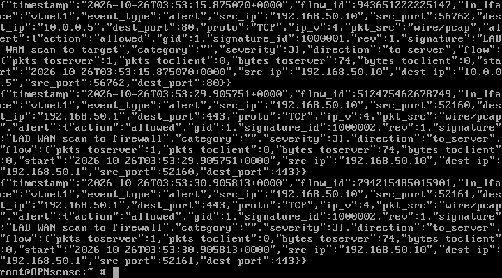
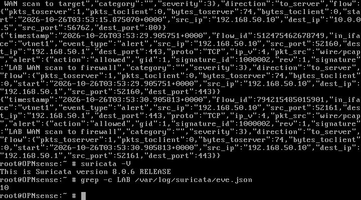

# Suricata IDS Validation — WAN Scan (2026-10-26)

**Objective:** Confirm that Suricata on OPNsense sees the WAN-side scan and raises alerts, even though the firewall blocks the traffic.

**Result:** **PASS** — Suricata 8.0.6 generated **10 lab alerts** for the scan from `192.168.50.10`.

---

## Setup

| Component | Detail |
|---|---|
| Firewall | OPNsense 26.7, WAN `192.168.50.1/24`, LAN `10.0.0.1/24` |
| IDS | Suricata 8.0.6 RELEASE, manual pcap capture on `vtnet1` |
| Rules | [`detections/suricata/lab.rules`](../../detections/suricata/lab.rules) (SID 1000001–1000003) |
| Attacker | `Attacker-MSF` on `Vung_WAN`, `192.168.50.10/24` |
| Target | Metasploitable 2 `10.0.0.5/24` |

Command:

```sh
suricata -c /usr/local/etc/suricata/suricata.yaml -i vtnet1 \
  -S /root/lab.rules -l /var/log/suricata -D
```

---

## Alerts Observed

```text
2026-10-26T03:53:15.875070+0000  vtnet1
  signature_id=1000001  signature="LAB WAN scan to target"
  src=192.168.50.10:56762  dst=10.0.0.5:80  proto=TCP  action=allowed

2026-10-26T03:53:29.905751+0000  vtnet1
  signature_id=1000002  signature="LAB WAN scan to firewall"
  src=192.168.50.10:52160  dst=192.168.50.1:443  proto=TCP  action=allowed

2026-10-26T03:53:30.905813+0000  vtnet1
  signature_id=1000002  signature="LAB WAN scan to firewall"
  src=192.168.50.10:52161  dst=192.168.50.1:443  proto=TCP  action=allowed
```

```text
suricata -V  -> This is Suricata version 8.0.6 RELEASE
grep -c LAB  -> 10
```





---

## Analysis

- The IDS sees the SYN packets on the **WAN interface before firewall filtering**, so detection and prevention are independent controls.
- The firewall block (documented in [`firewall-test-20261026.md`](firewall-test-20261026.md)) still holds; Suricata adds visibility, not forwarding.
- The `action=allowed` field is Suricata's own action; OPNsense still drops the packets at the firewall.
- This demonstrates the value of **defense in depth**: firewall + IDS + logs.

---

## Password Reset Context

The OPNsense admin password was unknown. It was reset offline by editing the bcrypt hash in `config.xml` on a copy of the disk, booting a test domain, verifying the web login, and only then applying the copy to the main VM.

- Backup: `/home/nnam09/VM/lab/OPNsense-Lab6-backup-20261026.qcow2`
- New password is **not stored in this repository**.
- Details: [`docs/opnsense-password-recovery.md`](../../docs/opnsense-password-recovery.md)

---

## Limitations

| Item | Status |
|---|---|
| OPNsense IDS service | Bypassed; Suricata run manually for validation |
| Ruleset | Custom lab rules, not ET Open/OPNsense-managed rules |
| Wazuh integration | Not configured; alerts remain local on OPNsense |
| IPS mode | Not tested (IDS/pcap only) |
| Rule download | Blocked by the isolated WAN; no internet ruleset update |

## Cleanup

Suricata was stopped with `killall suricata`; the VM was shut down after validation. The custom rule file and `installed_rules.yaml` remain on the OPNsense disk for reproducibility.
