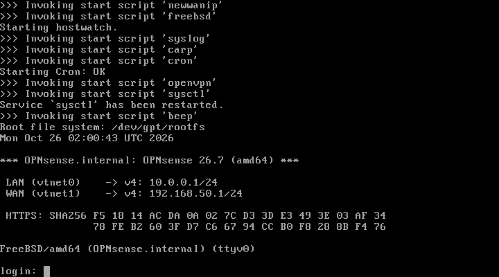
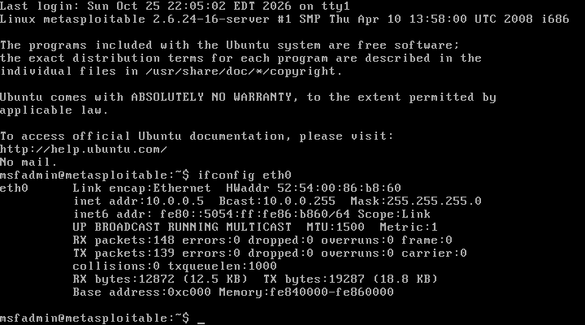

# Network Security Mode — Restoration & Validation (2026-10-26)

**Scope:** Recreate the missing `Vung_LAN` / `Vung_WAN` libvirt networks, restore the OPNsense + Metasploitable 2 lab from Lab 6, make the target address stable, and verify end-to-end connectivity.

**Result:** **PASS** — both VMs start, OPNsense LAN reachable, Metasploitable receives `10.0.0.5` via DHCP reservation, services verified.

---

## Problem Found

```
virsh net-list --all
  cape-network, default, soc-net

OPNsense-Lab6 NICs : Vung_LAN, Vung_WAN  -> network not found
Metasploitable2 NIC: Vung_LAN            -> network not found
```

Both VMs were defined but could not start because their source networks had been deleted. Lab 6 also used `192.168.50.0/24` for `Vung_WAN`, which collides with `soc-net`.

---

## Networks Recreated

| Network | Bridge | Subnet | Host IP | Purpose |
|---|---|---|---|---|
| `Vung_WAN` | `virbr71` | 192.168.50.0/24 | none (L2-only) | OPNsense WAN `.1`; isolated, no forward |
| `Vung_LAN` | `virbr72` | 10.0.0.0/24 | 10.0.0.254 | OPNsense LAN `.1`, Metasploitable `.5` |

`Vung_LAN` now includes:

```xml
<dhcp>
  <range start='10.0.0.100' end='10.0.0.200'/>
  <host mac='52:54:00:86:b8:60' name='metasploitable' ip='10.0.0.5'/>
</dhcp>
```

This fixes the guest having **no IPv4 address** after boot (eth0 was up but DHCP had no server) without editing the Metasploitable disk.

---

## Validation

### OPNsense 26.7

```text
LAN (vtnet0) -> v4: 10.0.0.1/24
WAN (vtnet1) -> v4: 192.168.50.1/24
HTTPS: 10.0.0.1 -> HTTP 200
ICMP:  3/3 received, 0% loss
```



### DHCP lease

```text
Expiry Time           MAC address         Protocol  IP address   Hostname
2026-10-26 10:10:30   52:54:00:86:b8:60   ipv4      10.0.0.5/24  metasploitable
```



### Target services

```text
PORT   STATE SERVICE VERSION
21/tcp open  ftp     vsftpd 2.3.4
22/tcp open  ssh     OpenSSH 4.7p1 Debian 8ubuntu1 (protocol 2.0)
80/tcp open  http    Apache httpd 2.2.8 ((Ubuntu) DAV/2)
```

```text
HTTP/1.1 200 OK
Server: Apache/2.2.8 (Ubuntu) DAV/2
X-Powered-By: PHP/5.2.4-2ubuntu5.10
```

### Automated check

```text
PASS OPNsense-Lab6   libvirt state    running
PASS Metasploitable2 libvirt state    running
PASS Vung_LAN        network          active
PASS 10.0.0.1        ICMP             reachable
PASS 10.0.0.1        HTTPS            HTTP 200
PASS 10.0.0.5        DHCP lease       52:54:00:86:b8:60 -> 10.0.0.5
PASS 10.0.0.5        ICMP             reachable
PASS 10.0.0.5        target service   tcp/21 open
PASS 10.0.0.5        target service   tcp/22 open
PASS 10.0.0.5        target service   tcp/80 open
PASS=10 FAIL=0 SKIP=0
```

Script: [`automation/network-lab-check.sh`](../../automation/network-lab-check.sh)

---

## Design Notes

- `Vung_WAN` is **L2-only** (no host IP) to avoid the duplicate `.1` address that broke Lab 6. OPNsense exclusively owns `192.168.50.1`.
- `Vung_WAN` has no forward/NAT, so the lab is isolated from the internet.
- `Vung_WAN` still overlaps `soc-net` (`192.168.50.0/24`). This is safe while SOC VMs are off; renumber OPNsense WAN to `192.168.70.0/24` when convenient.
- The Parrot host is on `Vung_LAN` (`10.0.0.254`) for validation. A real attacker VM should sit on `Vung_WAN` so traffic passes through OPNsense.

---

## Limitations / Next Steps

| Item | Status |
|---|---|
| WAN-side attacker (Kali on `Vung_WAN`) | Not yet attached; needed for true through-firewall recon |
| Suricata IDS on OPNsense | Not enabled |
| OPNsense/Suricata logs to Wazuh | Not configured |
| Attack scenario (vsftpd 2.3.4) + PCAP | Not captured |
| DoS test + mitigation evidence | Not performed |
| Metasploitable ACPI shutdown | Does not honor ACPI; use console `sudo poweroff` (verified) or `virsh destroy` after timeout |

---

## Final State

```text
OPNsense-Lab6   shut off
Metasploitable2 shut off
Vung_LAN        active (DHCP reservation persists)
Vung_WAN        active (L2-only)
SOC VMs         shut off
```

Both VMs were shut down gracefully (Metasploitable via console `sudo poweroff`).

See [`architecture/network-security-mode.md`](../../architecture/network-security-mode.md) for the full mode documentation and course mapping.
